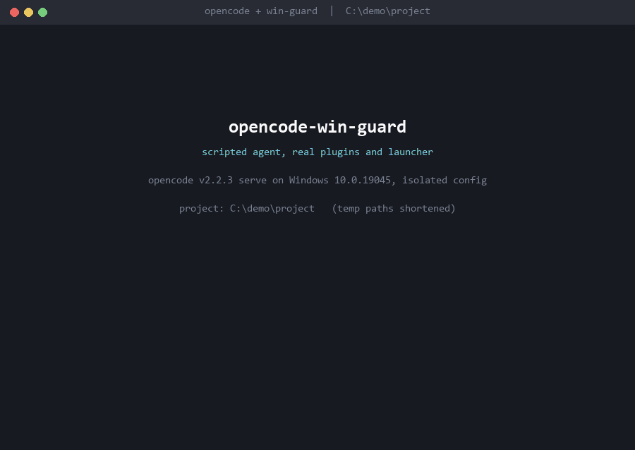

# opencode-win-guard

[English](../../README.md) · [简体中文](README.zh-CN.md) · [日本語](README.ja.md) · [한국어](README.ko.md) · [Español](README.es.md) · [Português (Brasil)](README.pt-BR.md) · **Deutsch** · [Français](README.fr.md) · [Русский](README.ru.md)

> Dies ist eine Übersetzung. Maßgeblich ist das [englische README](../../README.md); wo sie sich unterscheiden, gilt das englische.

Eine Schreib-Sandbox und ein Not-Aus für [opencode](https://opencode.ai)-Agenten unter **Windows**, damit Agenten unbeaufsichtigt in einem Projektordner arbeiten können. Keine Administratorrechte, kein Docker, kein WSL, kein Netzwerkzugriff.



*Ein geskripteter Agent gegen die echten Plugins und den Launcher in einem isolierten `opencode serve`.*

| Teil | Was er tut |
|---|---|
| **Sandbox** (`win-guard-sandbox.js` + Launcher) | Die Agenten lesen alles, schreiben aber nur innerhalb des Projektordners. Bei `edit`/`write` prüft das Plugin den echten Pfad (Links aufgelöst). Bei der Shell verweigert **Windows selbst** jedes Schreiben, Löschen und jede Rechteänderung außerhalb des Ordners: Befehle laufen mit einem Token der Integritätsstufe Low, und nur der Projektordner und ein Cache-Ordner tragen das Low-Label. |
| **Geheime Dateien** (Launcher, `secrets.txt`) | Dateien mit Schlüsseln und Passwörtern (SSH-Schlüssel, Cloud-Zugangsdaten, Browser-Schlüssel, das eigene Dienstpasswort von opencode...) bekommen ein Mandatory Label, an dem Low-Programme beim Lesen nicht vorbeikommen. Deine eigenen Programme sind nicht betroffen. |
| **Limits** (Launcher) | Jeder Befehl läuft in einem Job-Objekt: eine harte Speichergrenze, die eine festgelegte Menge RAM für dich frei hält, ein Minimum an freiem Speicherplatz, eine Höchstgröße für Projekt plus Cache. Wird ein Limit überschritten, wird der Befehl beendet (Exit-Code 125). |
| **Killswitch** (`win-guard-killswitch.js`) | Prüft jeden Aufruf, **bevor er läuft**: den Shell-Befehl und die Skripte des Projekts, die er startet (`build.ps1`, `npm test`-Skripte...). Eindeutig schädliche Aufrufe (Schlüssel lesen, Windows nach gespeicherten Passwörtern fragen, Datenträger löschen, Defender abschalten, opencode von außen steuern...) stoppen sofort **alle Agenten des Ordners**. Riskante (ein Skript ungesehen herunterladen und ausführen, Dateien hochladen, Autostart-Einträge) werden abgelehnt. Auch eine Datei `STOP` im Projekt, viele abgelehnte Aufrufe oder das Verschwinden eines großen Teils der Projektdateien stoppen sie. Der Stopp übersteht einen Neustart von opencode, bis du eine Nachricht schreibst. |

Es schützt vor den Fehlern eines Agenten und vor schädlichen Befehlen, zu denen man ihn überreden kann. Es ist keine Mauer gegen ein Programm, das gezielt zum Ausbrechen geschrieben wurde: Lies das [Sicherheitsmodell](../security-model.md), bevor du dich darauf verlässt.

## Voraussetzungen

- Windows 10 oder 11, NTFS.
- opencode 2.2 oder neuer (V2-Plugin-API). Getestet mit opencode 2.2.3 unter Windows 10 22H2.
- Der C#-Compiler des .NET Framework 4 (`%SystemRoot%\Microsoft.NET\Framework64\v4.0.30319\csc.exe`). Er ist Teil von Windows, es muss also nichts installiert werden: Das Installationsskript baut den Launcher aus den Quellen in [`launcher/`](../../launcher), und es wird kein vorgefertigtes Programm heruntergeladen.
- Für bash: Git for Windows. Das Installationsskript kopiert es (etwa 400 MB) in den Sandbox-Ordner, weil Git Bash nur aus einer eigenen Kopie heraus mit Integritätsstufe Low startet. Ohne Git (`-NoGit`) bekommen die Agenten PowerShell und cmd.

## Installation

Lade den Quellcode des [neuesten Releases](https://github.com/retretor/opencode-win-guard/releases/latest) herunter (oder klone das Repository) und führe dann in PowerShell aus:

```powershell
cd opencode-win-guard
.\install.ps1 -Folder C:\Users\me\Projects\my-project
```

Das Installationsskript baut den Launcher nach `~\.local\share\opencode\sandbox\bin`, kopiert Git, legt `secrets.txt` und `~\.config\opencode\win-guard.json` aus den Beispielen an (vorhandene bleiben erhalten), kopiert die Plugins nach `~\.config\opencode\plugins` und verschließt die Dateien aus `secrets.txt`. Danach:

1. **Lies `~\.local\share\opencode\sandbox\secrets.txt`** und füge die Dateien mit Schlüsseln und Passwörtern deines Computers hinzu. `protect.exe --list` im Ordner `bin` zeigt, was verschlossen ist.
2. Starte opencode neu und beginne eine Sitzung im Projektordner. Das Log `~\.local\share\opencode\log\win-guard.log` meldet `on for <folder>`.

Führe `install.ps1` erneut aus, um zu aktualisieren; um alles zu entfernen, `uninstall.ps1` (`-RemoveData` löscht auch die Git-Kopie, die Caches und die Einstellungen). Wenn PowerShell sich weigert, das Skript auszuführen, starte es mit `powershell -ExecutionPolicy Bypass -File .\install.ps1 ...`.

## Einstellungen: `~\.config\opencode\win-guard.json`

```json
{
  "folders": ["C:\\Users\\me\\Projects\\my-project"],
  "limits": { "ramFreeGB": 4, "diskFreeGB": 15, "folderGB": 15 },
  "agents": "*",
  "extraTools": [],
  "alsoWritable": [],
  "lowLabel": [],
  "env": {},
  "language": "en"
}
```

| Schlüssel | Standard | Bedeutung |
|---|---|---|
| `folders` | (erforderlich) | Absolute Pfade. Eine Sitzung, die in einem davon (oder darunter) gestartet wird, ist geschützt; überall sonst ändert sich nichts. Ein ganzes Laufwerk, dein Benutzerordner oder ein Systemordner werden abgelehnt. |
| `limits.ramFreeGB` | 4 | Speicher, der immer für dich frei bleibt. Ein Befehl wartet bis zu 60 s darauf, um starten zu können, und wird beendet, wenn der freie Speicher darunter fällt. |
| `limits.diskFreeGB` | 15 | Freier Speicherplatz, der auf dem Laufwerk des Ordners erhalten bleibt. |
| `limits.folderGB` | 15 | Höchstgröße des Ordners samt seinem Cache. |
| `agents` | `"*"` | Agenten, die geschützt werden: `"*"` für alle oder eine Liste von Namen. Andere (etwa dein eigener interaktiver Agent) arbeiten mit vollen Rechten. Mit einer Liste darf ein geschützter Agent nur Subagenten aus dieser Liste starten. |
| `extraTools` | `[]` | Tools anderer Plugins, die die Agenten benutzen dürfen. Jedes Tool, von dem nicht bekannt ist, dass es nichts schreibt, wird abgelehnt, weil ein neues Plugin oder ein neuer MCP-Server mit vollen Rechten laufen würde. Füge einen Namen nur hinzu, wenn das Tool nichts schreibt oder seine Schreibzugriffe selbst prüft, z. B. `["crew_list", "crew_send"]` für [opencode-crew-mail](https://github.com/retretor/opencode-crew-mail). |
| `alsoWritable` | `[]` | Weitere Ordner, die `edit` und `write` ändern dürfen (nicht die Shell). |
| `lowLabel` | `[]` | Weitere Ordner, die das Low-Label bekommen, damit Programme in der Sandbox dort schreiben können. Pfade dürfen mit `%APPDATA%`, `%LOCALAPPDATA%` oder einer anderen Umgebungsvariable beginnen. Nützlich für den Datenordner eines Programms, das im Projekt gebaut wird: Ein solches Programm läuft mit herabgesetzten Rechten (auch wenn du es selbst startest) und kann fehlschlagen, wenn es seine Einstellungen oder Speicherstände nicht schreiben kann. Ein fehlender Ordner wird angelegt. |
| `env` | `{}` | Weitere Umgebungsvariablen für Befehle in der Sandbox, z. B. `{ "CARGO_HOME": "${cache}/cargo" }`. `${cache}` ist der Cache-Ordner des Projekts, `${folder}` der Projektordner. Die Sandbox verlegt bereits die Caches von npm, yarn, pnpm, bun, pip, uv, Poetry, Go, Gradle, NuGet und .NET dorthin, außerdem `TEMP`, `APPDATA` und `LOCALAPPDATA`. |
| `language` | `"en"` | Sprache des Hinweises bei einem Stopp: `"en"`, `"zh-CN"`, `"ja"`, `"ko"`, `"es"`, `"pt-BR"`, `"de"`, `"fr"` oder `"ru"`. Weitere sind willkommen, siehe [CONTRIBUTING.md](../../CONTRIBUTING.md#translations). |

Eine fehlerhafte Einstellungsdatei schaltet den Schutz nicht ab: Die Shell wird abgelehnt, und das Log sagt, warum.

## Was die Agenten sehen

- Einmal pro Sitzung wird ihnen gesagt, wo sie schreiben dürfen, dass geheime Dateien nicht geöffnet werden können, welche Limits gelten und dass schädliche Aufrufe alle stoppen.
- Ein abgelehnter Tool-Aufruf gibt `Blocked: ...` mit dem Grund zurück; Ablehnungen durch Windows erscheinen in der Shell als „Access denied“.
- Exit-Codes des Launchers: **125** ein Limit oder `STOP` hat den Befehl beendet oder verhindert, **126** der Befehl wurde nicht gestartet (Sandbox unvollständig). Ersatzweise mit vollen Rechten läuft der Befehl nie.
- Nach einem Not-Aus schlägt jeder Aufruf mit `EMERGENCY STOP: <reason>` fehl, die Agenten werden unterbrochen (die Hauptagenten zuerst), und `AGENT_STOPPED.txt` im Projekt beschreibt, was passiert ist. Lösche die Datei `STOP`, falls du eine angelegt hast, und schreib dann irgendeine Nachricht in einer Sitzung des Ordners.

## Die Agenten selbst stoppen

Lege im Projektordner eine Datei namens `STOP` an. Laufende Befehle werden innerhalb von ein, zwei Sekunden beendet, neue starten nicht, und alle Agenten des Ordners werden unterbrochen.

## Zusammenarbeit mit anderen Plugins

- `globalThis[Symbol.for("opencode-win-guard.halted")]` ist ein `Set` der gestoppten Ordner (kleingeschrieben, mit Schrägstrichen). Ein Plugin, das Agenten von sich aus fortsetzt (ein Autopilot), sollte zuerst dort nachsehen.
- Tools anderer Plugins brauchen `extraTools`, siehe oben.

## Warum der Launcher in C# geschrieben ist

Die Sandbox braucht Windows-Funktionen, die kein Skript direkt aufrufen kann: ein eingeschränktes Token mit Integritätsstufe Low, `CreateProcessAsUser`, Job-Objekte mit Speichergrenzen und Mandatory Labels auf Dateien. C# erreicht sie mit einfachem P/Invoke, und sein Compiler kommt mit jedem Windows 10 und 11 als Teil des .NET Framework. Deshalb wird der Launcher bei der Installation auf deinem eigenen Computer aus den lesbaren Quellen gebaut, ohne SDK, ohne Download und ohne unsigniertes Programm aus dem Internet. Der Code beschränkt sich auf C# 5, damit dieser alte Compiler ihn bauen kann.

## Tests

```powershell
npm test                                   # pure parts, any OS
$env:WIN_GUARD_E2E = "1"; npm run test:e2e # also the launcher and both plugins in a real `opencode serve` with a fake model
```

Die End-to-End-Tests arbeiten in temporären Ordnern mit einer eigenen Geheimdatei, bauen den Launcher für sich selbst und setzen jedes Label zurück, das sie gesetzt haben. Sie rühren deine opencode-Konfiguration, deine Sitzungen und deine Sandbox nicht an und brauchen weder Provider noch Konto.

## Verwandte Projekte

Gefunden im November 2026; keines davon sperrt die Shell unter Windows in eine Sandbox oder stoppt einen ganzen Sitzungsbaum:

- [opencode-sandbox](https://github.com/Hamza-Abili/opencode-sandbox): eine Betriebssystem-Sandbox für die Shell mit bubblewrap (Linux) und Seatbelt (macOS); natives Windows wird nicht unterstützt.
- [opencode-guard](https://github.com/gigi206/opencode-guard): regelbasiertes deny/ask für Tool-Aufrufe plus ein optionales Entscheidungsmodell sowie das Schwärzen von Geheimnissen, bevor sie das Modell erreichen.
- [opencode-hook-safety](https://github.com/MansM/opencode-hook-safety): Sperrlisten für geheime Pfade und zerstörerische Befehle, optionaler Klassifikator.
- [opencode-damage-control](https://github.com/nicounii/opencode-damage-control): blockiert mehr als 90 gefährliche Befehlsmuster, drei Stufen von Pfadschutz.

Sie arbeiten auf der Ebene von Befehlstext und Pfaden; sie lassen sich gut mit diesem Projekt kombinieren, das die Ablehnung durch das Betriebssystem selbst hinzufügt.

## Mitwirken

Fehlerberichte, Ideen und Pull Requests sind willkommen: siehe [CONTRIBUTING.md](../../CONTRIBUTING.md). Wege, die Sandbox zu umgehen: Bitte melde sie vertraulich, siehe [SECURITY.md](../../SECURITY.md).

## Lizenz

[MIT](../../LICENSE)
